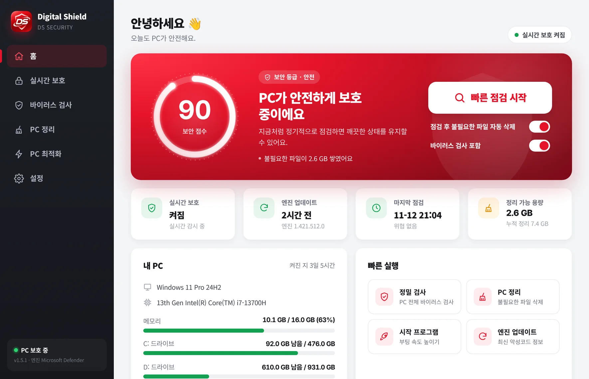

<h1 align="center">DS Digital Shield</h1>

바이러스 검사 · 실시간 보호 관리 · 파밍 점검 · PC 정리 · PC 최적화를 한 번에 하는 무료 Windows PC 보안 프로그램

<a href="https://dbstjd9061.github.io/digital-shield/"><b>홈페이지</b></a> · <a href="https://dbstjd9061.github.io/digital-shield/download/DigitalShield_Setup.exe"><b>무료 다운로드</b></a>

## 주요 기능
- **원클릭 빠른 점검:** 불필요한 파일 · DS 자체 검사 · 바이러스 검사 · 정리를 한 번에
- **실시간 보호 관리:** Microsoft Defender의 실시간 감시, 랜섬웨어 보호, 악성 사이트 차단, 방화벽 등을 한 화면에서
- **DS 자체 검사:** 파밍(hosts 변조), 악성 스크립트, 수상한 자동 실행, 프록시 가로채기, 백신 예외 악용, 위장 파일 점검
- **PC 정리 · 최적화:** 임시 파일·브라우저 캐시 정리, 시작 프로그램 관리, 매주 자동 정리
- **생활 보안:** USB 자동 검사, 위협 차단 알림, 오른쪽 클릭 검사, 알림 영역 실행

## 설치
1. [DigitalShield_Setup.exe](https://dbstjd9061.github.io/digital-shield/download/DigitalShield_Setup.exe) 내려받기
2. 실행 → [설치]
3. "Windows의 PC 보호" 창이 뜨면 [추가 정보] → [실행]

지원: Windows 10 / 11 (64비트)

## 검사 엔진
바이러스 검사는 Windows 내장 **Microsoft Defender**를 사용하고, 다른 백신 사용으로 Defender가 꺼져 있으면 **Microsoft Safety Scanner**를 사용합니다. 여기에 DS가 직접 만든 점검 규칙(DS 자체 검사)을 더했습니다.

[이용약관](https://dbstjd9061.github.io/digital-shield/terms.html) · [개인정보 처리방침](https://dbstjd9061.github.io/digital-shield/privacy.html)
